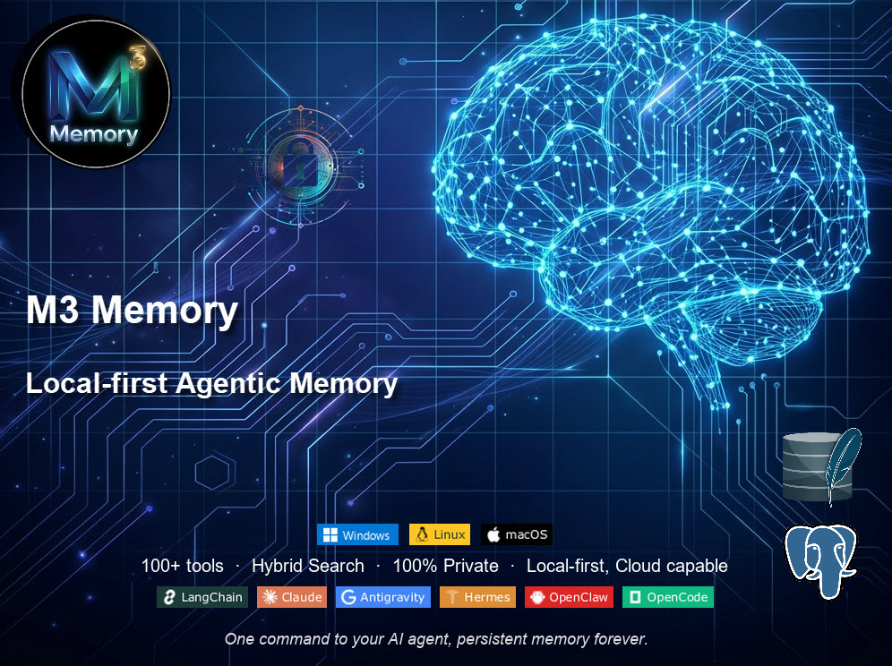
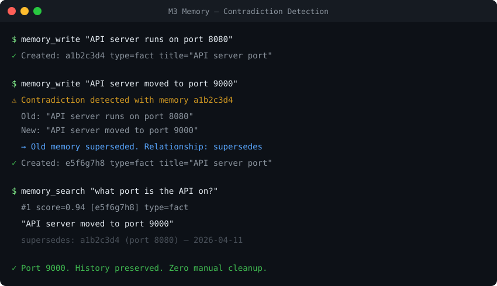
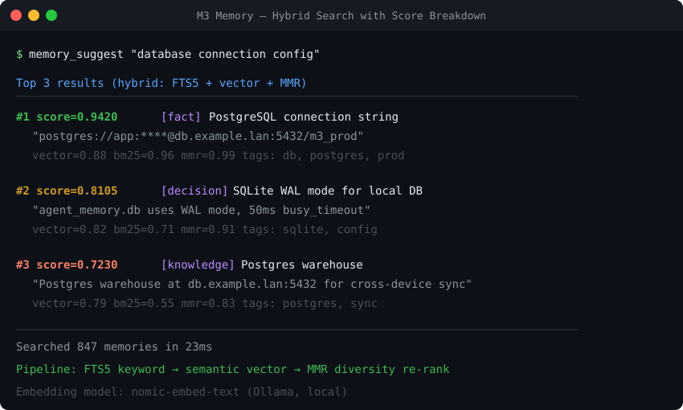
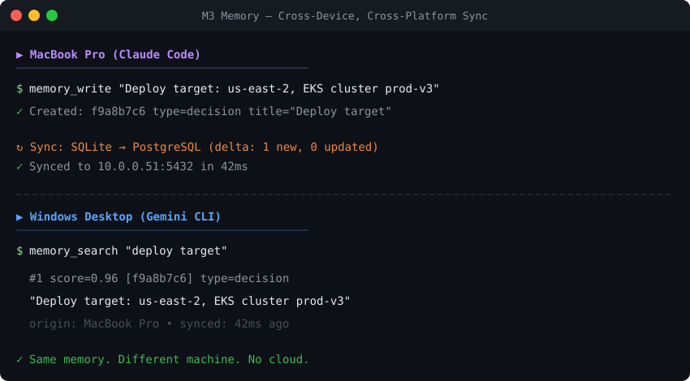
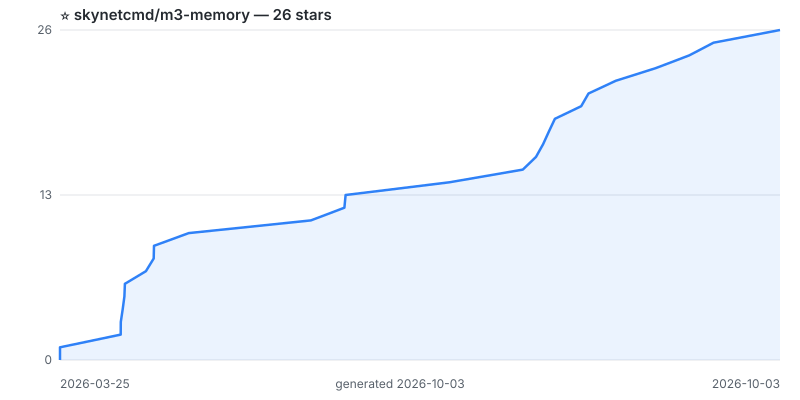

<p align="center">
  <a href="https://github.com/skynetcmd/m3-memory">
    
  </a>
</p>

# 🧠 m3 Memory

**Give your AI a memory that lasts.**

Your AI assistant is helpful until you start a new conversation and it has forgotten
what you were working on. m3 fixes that.

Your assistants remember your projects, preferences, decisions and past work, even after
you close the app, start a new session or switch to a
[different agent](docs/MCP_CLIENT_INSTALL.md). By default everything stays on your own
computer, and it [works offline](docs/SOVEREIGN_DEPLOYMENT.md). m3 itself needs no cloud
account or API key; your AI assistant may have its own requirements.

<p align="center">
  <a href="https://pypi.org/project/m3-memory/"></a>
  <a href="https://www.python.org"></a>
  <a href="https://github.com/skynetcmd/m3-memory/blob/main/LICENSE"></a>
  <a href="https://modelcontextprotocol.io"></a>
  
  
  
</p>

```bash
pipx install m3-memory  # or pip install m3-memory in a virtual environment; use one, not both
m3 setup                # finds your agents and connects them to m3
m3 doctor               # checks that everything is working
```

No pipx yet? `sudo apt install pipx` (Debian, Ubuntu), `brew install pipx` (macOS) or
`py -m pip install --user pipx` (Windows). If `m3` is not found right after installing,
open a new terminal.

**Setup finds your agents and connects m3 to them.** `m3 setup` detects your AI agents and wires m3 into each; if you run a local LLM (Ollama, LM Studio), it offers to use it to summarize and link your memories. That part is optional; to use it, install the LLM before `m3 setup`: [Windows](docs/QUICKSTART_WINDOWS.md#before-you-install-an-llm-for-memory-enrichment-optional) · [macOS](docs/QUICKSTART_MACOS.md#before-you-install-an-llm-for-memory-enrichment-optional) · [Linux](docs/QUICKSTART_LINUX.md#before-you-install-an-llm-for-memory-enrichment-optional). That's the whole install.

New here? The [5-minute Getting Started guide](docs/GETTING_STARTED.md) walks you through your first saved memory.

---

## What m3 is

m3 is a **memory layer** for AI agents: the AI assistants that work for you, such as
Claude Code, Codex, Cursor or Gemini CLI. It runs on your own computer and stores
facts, decisions, preferences and conversation history so your assistants can recall
them later, across sessions, across tools and across machines. Assistants reach it
through MCP, the standard way AI assistants connect to tools, and you can use it from
the command line too.

It is **not** an AI model or a chatbot. You keep using the assistants you already use;
they call m3 when they need to remember or recall something.

Put another way, m3 is the **knowledge layer** your assistants share. It keeps typed
memories (a decision is not just a chunk of chat), the history of how each one changed,
and a graph of the people, places and things they mention, with a confidence and a source
on each memory. It is local by default and speaks MCP. m3 is built for knowing what an
assistant knows, why, and since when, rather than for being the fastest vector index.

```text
  your assistants (Claude Code, Codex, Cursor, Gemini CLI, ...)
        |   MCP tools, or the m3 command line
        v
  +------------------------------ m3 ------------------------------+
  |  typed memories ---------- entity graph (people, places, ...)   |
  |  history: earlier versions are kept; "as of" a date         |
  |  search: keywords + meaning     optional background upkeep      |
  +-----------------------------------------------------------------+
        |   one SQLite file by default (PostgreSQL is optional)
        v
  recall in your next session  .  web dashboard  .  generated wiki
```

How the pieces fit together: [Architecture](docs/ARCHITECTURE.md).

---

## 📅 A week with m3

> **Monday:** you tell your AI assistant you're building a website and decide on PostgreSQL.
>
> **Wednesday:** you open a new session and ask, "Where did we leave off?" Your assistant
> finds the decision and carries on, without you repeating it.
>
> **Friday:** you switch agents, say from Claude Code to Codex. Codex sees the same project
> memory.

See it for yourself in a [short video](https://github.com/user-attachments/assets/09ab194a-d2a0-4fe5-a7db-69ae8225e39b)
of one agent saving a decision that another recalls. (Developers: the same thing
[from the command line](#-see-it-work).)

## ✨ What m3 does for you

| You want to... | m3... | Under the hood |
| :--- | :--- | :--- |
| Stop repeating yourself | remembers what you told it in earlier sessions | persistent memory over [MCP](docs/MCP_TOOLS.md) and a CLI |
| Pick up where you left off | keeps your conversations and finds them again | [chat-log capture](docs/CHATLOG.md) |
| Use more than one AI assistant | shares one memory across Claude Code, Cursor, Gemini CLI and [others](docs/MCP_CLIENT_INSTALL.md) | one local store, many clients |
| Find things in your own words | finds a memory even when you don't recall the exact words | [hybrid search](docs/TECHNICAL_DETAILS.md#ranking-signals): keywords plus meaning |
| Use fewer AI tokens | puts the most relevant memory first, and loads only six of its tools when your assistant connects | [the right session first for 91.8% of questions](#-benchmarks); [about 3,200 tokens of tool descriptions instead of 33,000](#integrations) |
| See how things connect | links related memories and builds a graph of the people, places and things they mention, which an assistant can follow up to 3 hops | [knowledge graph](docs/ARCHITECTURE.md), with an entity vocabulary you can configure (`entity.vocab_yaml`) |
| Keep track when things change | keeps the earlier version when a decision changes: similarity-based supersession on write, explicit corrections, and optional model-assisted contradiction review | [version history, supersession and contradiction checks](docs/TECHNICAL_DETAILS.md#contradiction-detection) |
| Keep your information private | stores everything on your computer and works offline | [SQLite by default; air-gap ready](docs/SOVEREIGN_DEPLOYMENT.md) |
| Let assistants work together | lets several assistants share notes, hand off work and split tasks | [multi-agent scopes and handoffs](docs/MULTI_AGENT.md) |
| Keep memory tidy | can tidy up in the background: links related facts, merges duplicates, fades stale notes | the built-in [cognitive loop](docs/MEMORY_MODEL.md#how-the-memory-maintains-itself) (enable it in `m3 setup`) |

Simple to understand, easy to start, powerful when you need it. Every row links to the
doc that backs it; [How memory works in m3](#how-memory-works-in-m3) explains the
mechanics, and the [technical summary](#at-a-glance) and [benchmarks](#-benchmarks)
carry the measurements.

---

## <a id="project-status"></a>📍 Project status

**The core is stable, and so are the web dashboard, the cognitive loop and the Observer & Reflector stages.**

| Status | What it means | Features |
| :--- | :--- | :--- |
| **Stable** | Safe to build on: tested on every release, and changes come with a deprecation notice. | Saving, searching, updating and superseding memories · hybrid search (keywords plus meaning) · version history · supersession on write · GDPR export and erasure · SQLite and PostgreSQL storage · MCP server and `m3` CLI · sync across machines · web dashboard · background cognitive loop · Observer & Reflector stages |
| **Planned** | Coming next, in this order ([ROADMAP](docs/ROADMAP.md#-planned--distribution--deployment)). | Health and Prometheus metrics endpoint · HNSW approximate search on PostgreSQL |

*   **Memory reads audited:** each memory read and search hit is logged with who read it, whose data it was and when, kept 90 days, and included in GDPR export and erasure ([GDPR](docs/GDPR_COMPLIANCE.md)). Chat-log reads are next.
*   **One config file:** `m3_config.toml` holds every setting, and `m3 config show` prints each one with where it came from ([Config reference](docs/CONFIG_REFERENCE.md)). Old environment-variable names are no longer read; `m3 doctor` names any still set ([Environment variables](docs/ENVIRONMENT_VARIABLES.md)).
*   **Predictable upgrades:** calendar versions (`YYYY.M.D.N`). A renamed setting, argument or tool keeps working, with a warning, before it is removed, and `m3 doctor` names anything you still use ([Changelog](CHANGELOG.md)).

---

## 🧩 More than a search index

Search is one part. What else m3 keeps, and where each part is documented:

| m3 keeps... | So that... | Details |
| :--- | :--- | :--- |
| **Typed memories** (decision, preference, fact, note, task and more), each with a title, metadata, a source and a confidence | a decision can be told from a passing remark, and filtered as one | [Memory model](docs/MEMORY_MODEL.md) |
| **History** of each memory: a changed fact closes the earlier version, it does not erase it | you can ask which version was valid on a given date (`as_of`) | [Memory model](docs/MEMORY_MODEL.md) · `memory_history` |
| **Supersession** on write, by similarity, and explicit (`memory_supersede`) | the current version is the one search returns | [How memory works](#how-memory-works-in-m3) |
| **An entity graph** with a vocabulary you can configure, and links between memories | an assistant can follow connections, up to 3 hops (`memory_graph`) | [Architecture](docs/ARCHITECTURE.md) |
| **Corroboration** (optional, off by default): which agents asserted the same thing | confidence can reflect how many agents said it | [How memory works](#how-memory-works-in-m3) |
| **A read log**: who read which memory, kept 90 days | you can audit access, and export or erase one person's data | [GDPR](docs/GDPR_COMPLIANCE.md) |

For how m3 differs from other memory systems, see [How m3 compares](#how-m3-compares)
and [COMPARISON.md](docs/COMPARISON.md).

---

## 🎯 Better memory, fewer wasted tokens

AI assistants can only work with so much text at once, and they measure it in
**tokens**: small pieces of words, which can also set what you pay. When your
assistant searches its memory, finding the right thing first means it reads less of
what it doesn't need.

```text
An illustration, not a measurement:

  less precise search               m3: the right memory first
  1. unrelated note                 1. ✔ the decision you need
  2. unrelated note                    (it may already have what it needs)
  3. ✔ the decision you need
  4. unrelated note
  5. unrelated note
```

On the [LongMemEval-S benchmark](#-benchmarks), the correct session was m3's first
result for **91.8%** of questions (459 of 500). That measures retrieval accuracy, not
token savings: how much your assistant saves depends on how it uses the results. m3
returns as many as it is asked for, so precise ranking lets an assistant ask for fewer,
or stop at the first good one, and keep more room for the work itself.

m3 saves context in a second, measured way: it registers only 6 of its 100+ tools when
an assistant connects, so their descriptions take about 3,200 tokens instead of about
33,000 for the full catalog ([Interfaces](#integrations)).

---

## How memory works in m3

When an agent (or you, from the shell) wants to remember something, it calls
`memory_write`. m3 stores the text exactly as given, with a type, title and metadata.
Later, `memory_search` finds it with hybrid retrieval: keyword matching (BM25),
semantic similarity (local BGE-M3 embeddings) and diversity re-ranking (MMR). Nine
signals contribute to the score, and every result can explain it.

When a fact changes, m3 does not overwrite it. Three mechanisms, each different:

- **Similarity-based supersession (on every write).** A new memory very similar to an
  older one of the same type (similarity above `memory.contradiction.threshold`, 0.92
  by default) but with different text becomes the current version: the older one's `valid_to` is closed,
  at the moment the newer memory was written (in a bulk write, at the newer one's own
  `valid_from`), and both stay queryable with `as_of`. It does not judge whether the two actually
  contradict, so a refinement ("PostgreSQL with connection pooling") replaces the
  older wording too, while a real contradiction worded very differently may not be
  caught at all; nothing is lost from the history either way. It applies only to an agent's
  own memories, and only when the write names its user or agent. Three settings tune
  it: `memory.contradiction.threshold` (raise it to supersede less often:
  `m3 config set memory.contradiction.threshold 0.95`),
  `memory.contradiction.title_gate` (`loose`, the default, needs only different text;
  `strict` also needs matching titles; `off` skips the text check) and
  `memory.contradiction.type_exclusions` (types never checked; `conversation` by
  default).
- **Explicit supersession.** An agent calls `memory_supersede` to replace a memory it
  knows is wrong.
- **Contradiction detection (model-assisted).** With the cognitive loop on, its
  Reflector stage uses a model to find memories that genuinely disagree and records
  them for resolution.

Separately, and **off by default**, `memory.corroboration.enabled` records a write that
repeats an existing memory (the same text, similarity at least
`memory.corroboration.threshold`, 0.95) as support for that memory; the new write is
still stored. The memory's confidence rises with the number of **distinct agents** that
asserted it. That counts who said it, not whether their information is independent: two
agents repeating one upstream claim count as two, and an agent repeating its own memory
counts once, too.

With the cognitive loop enabled, m3 also embeds new memories, extracts entities and
relationships, and decays memories that are not used. Rolling related notes up into
higher-level beliefs is a separate opt-in.

The default store is a single SQLite file. PostgreSQL is a first-class alternative when
you want one store shared across machines.

---


## <a id="at-a-glance"></a>⚡ m3 at a glance: technical capabilities

m3 is a persistent, local-first memory layer for AI agents: an MCP server and a
JSON-in, JSON-out command-line tool over the same store. It is not an LLM, a chatbot,
a plain vector database, a RAG framework or an agent runtime.

**m3 is more than a searchable memory store.** It combines hybrid keyword and semantic
retrieval, version history, automatic supersession, model-assisted contradiction
review, a knowledge graph and background memory maintenance (the cognitive loop).
Several agents can share one store; several machines can share one PostgreSQL database,
or keep local stores synced through a PostgreSQL warehouse. Your existing assistants
reach all of it through MCP, the CLI or framework integrations, with no new agent
runtime, and it can run entirely on your own hardware.

| Capability | Support | Details |
| :--- | :--- | :--- |
| Memory that persists across sessions and agents | Built in | Text is stored verbatim and survives restarts, new sessions and switching agents. ([Memory model](docs/MEMORY_MODEL.md)) |
| Hybrid retrieval | Built in | BM25 keywords (SQLite FTS5) plus local BGE-M3 vectors, with MMR for diversity: nine ranking signals, and every result can explain its score. ([Ranking signals](docs/TECHNICAL_DETAILS.md#ranking-signals)) |
| Version history | Built in | Every memory has a validity window (`valid_from`, `valid_to`); `as_of` returns the memories whose window contains a date. A correction closes the old version and never erases it. `as_of` filters that window only: it does not ask what the store held on a given day. ([Memory model](docs/MEMORY_MODEL.md)) |
| Similarity-based supersession | Built in | On every write, a very similar memory of the same type with different text becomes the current version. This is similarity, not a judgement of contradiction; the earlier version stays in the history (`memory_history`, `as_of`). ([Contradiction detection](docs/TECHNICAL_DETAILS.md#contradiction-detection)) |
| Explicit correction | Built in | `memory_supersede` records a replacement and keeps the previous version queryable. ([Memory model](docs/MEMORY_MODEL.md)) |
| Model-assisted contradiction review | With the cognitive loop and a model | The Reflector stage finds memories that may conflict and records them for resolution. ([How memory maintains itself](docs/MEMORY_MODEL.md#how-the-memory-maintains-itself)) |
| Knowledge graph | Built in | Links between memories (`memory_link`), an entity graph, and traversal up to 3 hops (`memory_graph`). Entities and relationships come from a vocabulary you can configure (`entity.vocab_yaml`; the default has people, places, organizations, events, products and more). It is a typed vocabulary, not a formal ontology: no class hierarchies or constraints. Names resolve to one entity by exact match, then fuzzy match within the same type (`entity.resolve_fuzzy_min`, 0.85), then embedding similarity (`entity.resolve_cosine_min`, 0.92). Entities are extracted rule-based by default, or by a model in the cognitive loop. ([Architecture](docs/ARCHITECTURE.md)) |
| Background maintenance (cognitive loop) | Built in; enable in `m3 setup` | Embedding, entity extraction, enrichment (Observer and Reflector), classification, session summaries, pruning, importance decay, sync and an audit chain. Passes that need a model use a local or cloud LLM. ([How memory maintains itself](docs/MEMORY_MODEL.md#how-the-memory-maintains-itself)) |
| Session recall | Built in | At a fresh session start, a numbered menu of your recent sessions (0 = none); summaries are written by the cognitive loop. |
| Multi-agent shared memory | Built in | Agent, user and org scopes, handoffs into another agent's inbox, shared task trees, and safe concurrent writes. Isolation between agents is advisory: `memory.enforce_agent_isolation` (off by default) makes a search return only the requesting agent's memories, and it does not restrict other tools. ([Multi-agent](docs/MULTI_AGENT.md)) |
| Several machines, one store | Built in | Every machine reads and writes one PostgreSQL 16+ database directly, with no separate synchronization step. ([Multi-agent](docs/MULTI_AGENT.md)) |
| Several machines, synced | Optional | Each machine keeps SQLite and syncs hourly, both ways, with a PostgreSQL warehouse (hub and spoke; the latest write wins). Deliberately not peer-to-peer: one hub keeps one place where conflicts are resolved and one network surface to secure. ([Sync](docs/SYNC.md)) |
| Local embeddings, offline use | Built in | BGE-M3 runs on your machine; nothing needs the internet after install, and air-gapped installs are supported. ([Sovereign deployment](docs/SOVEREIGN_DEPLOYMENT.md)) |
| Storage | Built in | SQLite by default: a database file, with no server to run. PostgreSQL 16, 17 and 18 tested; pgvector optional. ([Architecture](docs/ARCHITECTURE.md)) |
| Interfaces | Built in | MCP server; `m3` CLI with JSON on stdin and stdout; a remote MCP endpoint (`m3 serve`) behind a bearer token. ([CLI reference](docs/CLI_REFERENCE.md)) |
| Context efficiency | Built in | 100+ tools in 9 domains; only 6 load at startup (about 3,200 tokens, 1.6% of a 200K window), the rest on demand. ([Domain gating](#domain-gating)) |
| Agent integrations | Supported integrations | Claude Code, Codex, Gemini CLI and Antigravity (plugins and extension); Cursor, Cline, OpenCode and OpenClaw (wired by `m3 setup`); Hermes (memory provider); Aider (through a proxy). ([Integrations](#integrations)) |
| Framework integrations | Supported integrations | LangChain and LangGraph, CrewAI, PydanticAI. ([Integrations](#integrations)) |
| Chat capture | Built in | Conversation turns saved as they happen, before an agent compacts its context: Claude Code, Codex, Gemini CLI, Antigravity (app, IDE and CLI), OpenCode, OpenClaw and Aider. ([Chat log](docs/CHATLOG.md)) |
| Files memory | Built in | A 25-tool domain ingests and chunks whole directories. ([Files memory](docs/FILES_MEMORY.md)) |
| Dashboard and wiki | Built in | A local web dashboard (graph, browser, audit log, health); `m3 wiki generate` writes Markdown, HTML or an Obsidian vault. ([Dashboard](docs/DASHBOARD.md) · [Wiki](docs/WIKI.md)) |
| GDPR | Built in | Export (Art. 20) and erasure (Art. 17); every memory read and search hit is logged for 90 days. Chat-log reads are not audited yet. ([GDPR](docs/GDPR_COMPLIANCE.md)) |
| FIPS 140-3 | Ready | m3's cryptography runs through one provider that a validated module (wolfCrypt FIPS) can serve; m3 itself is not a validated product. ([FIPS boundary](docs/FIPS_MODULE_BOUNDARY.md)) |
| Remote clients | Verified | Claude.ai, the Anthropic API, the xAI API (Grok) and the OpenAI Responses API, through `m3 serve`. ChatGPT app connectors are not supported: they need OAuth. ([Remote clients](docs/REMOTE_MCP_CLIENTS.md)) |
| Approximate (HNSW) search | Planned | Search is exact today, accelerated by pgvector on PostgreSQL. ([Roadmap](docs/ROADMAP.md)) |

- **Tested:** 5,700+ tests on Windows, macOS and Linux × Python 3.12–3.15, plus a PostgreSQL (with pgvector) lane on Linux, with the native (Rust) core that ships with m3; warnings fail the build. Security scans are published in [`docs/audits/`](docs/audits/). ([Testing](docs/TESTING.md))
- **Status:** stable: the core, the web dashboard, the autonomous cognitive loop and the Observer & Reflector stages. Apache 2.0. ([Project status](#project-status) · [Roadmap](docs/ROADMAP.md))
- **Configuration:** one file, `m3_config.toml`. `m3 config show` prints every setting and where it came from. m3 "reads no setting from the environment, `.env` or `.llm_config.json`" (a few process-level variables, such as `M3_CONFIG_ROOT`, still locate files), and secrets are never read from the config file or the environment: they come from a user-only secrets file, the OS keyring or the encrypted vault. `m3 config import-env` moves old environment settings into the file once. ([Config reference](docs/CONFIG_REFERENCE.md) · [Environment variables](docs/ENVIRONMENT_VARIABLES.md))
- **Out of the box:** on by default are the entity graph on write (`memory.entity_graph`), links between related memories (`memory.auto_related_link`), fact enrichment of writes (`memory.fact_enriched`), intent and query-type routing in search, and the memory read log (`audit.read_log`). Off by default are model-based entity extraction at ingest (`ingest.auto_entities`), corroboration (`memory.corroboration.enabled`), agent-isolation enforcement (`memory.enforce_agent_isolation`), the cloud embedding fallback (`cloud.allow_fallback`), and applying belief consolidation, distilled procedures or chat-log pruning without review (`autonomy.consolidation_auto`, `autonomy.distill_auto`, `autonomy.chatlog_prune_auto`). The background cognitive loop that runs the maintenance passes is offered by `m3 setup`, and the default answer is yes.
- **For AI agents:** [llm-context.md](docs/llm-context.md) lists the real tool names and usage rules, and [features.json](docs/features.json) is the machine-readable summary.

---

## 🧭 Where to go next

**New to AI memory?** Start with the [5-minute Getting Started guide](docs/GETTING_STARTED.md),
then your system's install guide: [Windows](docs/QUICKSTART_WINDOWS.md) ·
[macOS](docs/QUICKSTART_MACOS.md) · [Linux](docs/QUICKSTART_LINUX.md). Something not
working? [Troubleshooting](docs/TROUBLESHOOTING.md) · [FAQ](docs/FAQ.md) ·
[Health FAQ](docs/M3_HEALTH_FAQ.md).

**Building with AI agents?** [Installation](#-installation) ·
[Client setup](docs/MCP_CLIENT_INSTALL.md) · [LangChain](docs/integrations/LANGCHAIN.md) ·
[CrewAI](m3_memory/integrations/crewai/README.md) ·
[PydanticAI](m3_memory/integrations/pydantic_ai/README.md) ·
[Agent instructions](docs/AGENT_INSTRUCTIONS.md) · [For AI agents](#-for-ai-agents) ·
[For developers](#for-developers) · [Coding guide](docs/CODING_FAQ.md) ·
[CLI reference](docs/CLI_REFERENCE.md).

**Evaluating memory systems?** [Benchmarks](#-benchmarks) ·
[Comparison with Mem0, Letta, Zep and others](docs/COMPARISON.md) ·
[Memory model](docs/MEMORY_MODEL.md) · [Architecture](docs/ARCHITECTURE.md) ·
[Technical details](docs/TECHNICAL_DETAILS.md) ·
[Sovereign deployments](#sovereign-air-gapped) · [Compliance](docs/COMPLIANCE.md).

Every document: the [documentation index](docs/README.md).

---

## 🤝 Multi-agent memory and cross-machine use

**One memory layer for many agents and machines.** m3 supports concurrent agents sharing
one database; separate agent, user and organization scopes; handoffs and shared tasks;
and two cross-machine models: direct access to one shared PostgreSQL database, or local
SQLite stores synced through a PostgreSQL warehouse.

Several agents can share one m3 memory at the same time. Each memory carries a scope:
**agent** (one agent's own notes), **user** or **org**. Agents coordinate through
**handoffs** into another agent's inbox and through **shared task trees**. Writes are
safe under concurrency: on SQLite, 16 agents writing at once completed 640 writes with
no failures, each waiting at most half a second. Isolation between agents is advisory
by default; the opt-in `memory.enforce_agent_isolation` restricts a search to the
requesting agent's memories (searches only, not every tool).

Across machines there are two setups, and they work differently:

- **One shared PostgreSQL store.** Every machine reads and writes the same PostgreSQL
  16+ database. There is no separate synchronization step; this is the setup for a fleet.
- **Sync with a warehouse.** Each machine keeps its own SQLite store and syncs every
  hour, in both directions, with a PostgreSQL warehouse: memories, embeddings,
  relationships, tasks and chat-log rows. The warehouse is the hub (machines never
  sync with each other directly), and the most recent write wins. Some local-only data,
  such as the entity graph, stays on its machine.

SQLite is the default and `m3 setup` keeps it. To move to a shared PostgreSQL store:
`pip install "m3-memory[postgres]"`, store the server's address with
`m3 secret set M3_PRIMARY_PG_URL`, then run `m3 install-m3 --db-backend postgres`.

For clients that cannot run m3 locally, `m3 serve` exposes the memory as a remote MCP
endpoint behind a bearer token.
([Multi-agent](docs/MULTI_AGENT.md) · [Sync](docs/SYNC.md) · [Remote clients](docs/REMOTE_MCP_CLIENTS.md))

---

## 📊 Benchmarks

> **To compare retrieval quality, start with Session Hit-Rate (SHR).** SHR measures
> whether the memory system retrieves the session holding the evidence a question needs,
> independently of the model that writes the answer.
>
> **End-to-end QA accuracy** measures a different outcome: whether the whole system
> produces the correct answer. It depends on retrieval, the answer model, the prompt and
> the judge, and those are rarely held constant across published comparisons.
>
> m3 reports both and uses SHR as its primary retrieval benchmark. SHR does not measure
> everything a memory layer does (supersession, history, maintenance and multi-agent
> coordination are not scored by it).

### Retrieval Accuracy — Session Hit-Rate @ k *(the primary retrieval metric)*
Evaluated on the 500-question [LongMemEval-S](https://github.com/xiaowu0162/LongMemEval) dataset, using m3's production search function:

| Retrieve Depth (k) | Session Hit-Rate (SHR) ⁂ | Success Count |
| :---: | :---: | :---: |
| 1 † | **91.8%** | 459 / 500 |
| 5 | **98.2%** | 491 / 500 |
| 8 (default) | **99.2%** | 496 / 500 |
| 10 | **99.2%** | 496 / 500 |
| 20 | **100.0%** | 500 / 500 |

Compared with the previous engine, v3 improves SHR@5 from 96.2% to 98.2% and SHR@10
from 96.8% to 99.2%. It reaches 100% at k=20, where the previous engine reported 97.8%
at k=30 ([LongMemEval issue #43](https://github.com/xiaowu0162/LongMemEval/issues/43)).
All of these are retrieval-only measurements, with no answer model.

> † **SHR@1** measures whether the correct session is the top-ranked result. High first-result accuracy can let an agent retrieve less context, when its retrieval strategy supports it. **SHR@8** is m3's default search depth: a gold session is present for 99.2% of questions, the same as at k=10, which retrieves 25% more rows on LongMemEval-S for no gain. Other systems usually report k=5, k=10, k=20 or k=50; compare at the same k, using m3's figure for that depth.

> ⁂ **Which aggregation.** These are binary per-question `recall_any@k` values — the convention adjacent LongMemEval submissions report. The benchmarking report's per-question-type table aggregates slightly differently and reads marginally higher at shallow depth (98.8% at k=5, 99.4% at k=10); k=20 is 100.0% either way. The table above quotes the more conservative figures.

### End-to-End QA Accuracy *(depends on the answer model and the judge)*
**92.0% accuracy** (460/500 correct responses) without using the dataset's question-type labels (no oracle routing).
This measures the whole system; see the note above on why it is not
comparable across systems the way SHR is:

| Question Domain | Count (n) | Accuracy |
| :--- | :---: | :---: |
| single-session-user | 70 | 94.3% |
| single-session-assistant | 56 | 96.4% |
| single-session-preference | 30 | 80.0% |
| multi-session | 133 | 87.2% |
| temporal-reasoning | 133 | 95.5% |
| knowledge-update | 78 | 93.6% |
| **Overall Summary** | **500** | **92.0%** |

> **How the QA figure was produced.** m3 retrieves; it does not answer questions. In deployment the calling agent chooses what to retrieve and writes the answer. The benchmark harness plays that role: it chooses retrieval options per question (session expansion and a precomputed recall surface, both available in m3's engine but off by default) using a question-text router that is part of the harness, and it supplies the answer prompts and model. m3's built-in intent routing is on by default in both. The retrieval figures (SHR) use m3's search alone.

*Methodology and reproducibility details are located in the [LongMemEval-S Benchmarking Report](benchmarks/longmemeval/LME-S_Benchmarking_Report.md).*

### Performance

- **Writes:** about **2 ms** with the embedding deferred: text search finds the memory
  at once, and with the cognitive loop enabled, semantic search finds it in under 30
  seconds. With the embedding inline, a write takes about 31 ms.
- **Search:** about 45 ms (p50) on the benchmark store. At 50,000 memories, 0.45 s on
  SQLite and 0.27 s on PostgreSQL with pgvector. A real 83,000-memory store answers in
  2.7 s on SQLite, or 0.54 s on PostgreSQL with pgvector.
- **Concurrency:** 16 agents writing to SQLite at once lost nothing and waited at most
  half a second.
- **Native core:** the Rust core speeds up MMR re-ranking 95× to 846× and batch cosine
  97× to 178×; without it, results are the same, more slowly.

([Performance](docs/PERFORMANCE.md) · [Oxidation benchmarks](docs/OXIDATION_BENCHMARKS.md))

---

## <a id="domain-gating"></a><a id="integrations"></a>🔌 Interfaces and integrations

**Two interfaces, one store.** The MCP server and the `m3` CLI reach the same
database. Every tool reads JSON on stdin and writes JSON on stdout, grouped as
`memory`, `files`, `chatlog`, `tasks`, `agent`, `admin`, `conversations`,
`diagnostics` and `entity`. A dropped MCP connection is not a memory outage: the CLI
keeps working until the client reconnects.

**The full catalog without the context cost.** 100+ tools sit in 9 domains, but only 6
register at startup: `memory_write`, `memory_search`, `memory_supersede`,
`memory_get`, `chatlog_search` and `m3_call`. Across real development sessions the four
memory tools (`memory_write`, `memory_search`, `memory_supersede`, `memory_get`) took
95% of all direct tool calls. An agent reaches any other tool by name
through `m3_call`, or loads a whole domain.

| Gating mode | Registered tools | Tokens in schema | Share of a 200K window |
| :--- | :---: | :---: | :---: |
| **Lazy (Default)** | **6** | **~3,217** | **1.6%** |
| Typical Active Session (+`memory` +`admin`) | 60 | ~19,549 | 9.8% |
| Eager Mode (`tools.lazy = false`) | 120 | ~33,149 | 16.6% |

**Agents and frameworks:**

| Agent or framework | How it connects |
| :--- | :--- |
| Claude Code | Plugin (`/plugin marketplace add skynetcmd/m3-memory`, then `/plugin install m3@skynetcmd`): `/m3:*` commands, curation subagents, chat capture. Or `m3 setup`. ([Plugin](docs/claude_code_plugin.md)) |
| Codex | Plugin (`codex plugin marketplace add skynetcmd/m3-memory`, then install **m3** from `/plugins`): skills, chat capture, session start. Or `m3 setup`. ([Plugin](docs/codex_plugin.md)) |
| Gemini CLI | Extension (`gemini extensions install https://github.com/skynetcmd/m3-memory`) or `m3 setup`, which also wires chat capture. ([Extension](docs/gemini_extension.md)) |
| Google Antigravity | Plugin or `m3 setup`. ([Plugin](docs/antigravity_plugin.md)) |
| Cursor, Cline, OpenCode, OpenClaw | `m3 setup` wires each one it finds; OpenClaw needs 2026.3.22 or newer. ([Client setup](docs/MCP_CLIENT_INSTALL.md)) |
| Hermes Agent | m3 as its memory provider, wired by `m3 setup`. ([Hermes](docs/HERMES.md)) |
| Aider | Through m3's MCP-to-OpenAI proxy, with a chat-log watcher. ([Client setup](docs/MCP_CLIENT_INSTALL.md)) |
| LangChain and LangGraph | Python library: store, retriever and checkpointer (`pip install "m3-memory[langchain]"`). ([Guide](docs/integrations/LANGCHAIN.md)) |
| CrewAI | Storage backend (`pip install "m3-memory[crewai]"`). ([Guide](m3_memory/integrations/crewai/README.md)) |
| PydanticAI | Toolset and history processor (`pip install "m3-memory[pydantic-ai]"`). ([Guide](m3_memory/integrations/pydantic_ai/README.md)) |
| Claude.ai, Anthropic API, xAI API, OpenAI API | Remote MCP through `m3 serve`. ChatGPT app connectors are not supported (OAuth only). ([Remote clients](docs/REMOTE_MCP_CLIENTS.md)) |

---

## <a id="sovereign-air-gapped"></a>🛡️ Privacy, security and operations

After installation, m3 runs offline by default. It contacts the internet only for what you turn on: a cloud LLM you configure for enrichment, sync with a warehouse you name, and the daily version check if you said yes to it in `m3 setup` (a single request to pypi.org).

### Sovereign Local Embedder
BGE-M3 (1,024 dimensions) runs on your machine after installation: one shared embed
server on `127.0.0.1:8082` that every m3 process reuses, so one model sits in memory.
In-process embedding is an opt-in at `m3 setup`: about 1.9× faster on short text and
1.75× on medium text, at the cost of one model copy per process. `m3 embedder
install-gpu` adds a CUDA build (tested) or Vulkan and Metal builds; any
OpenAI-compatible embeddings endpoint also works (`m3 config set embed.url …`).
([Embedding: shared vs in-process](docs/PERFORMANCE.md#embedding-and-the-shared-vs-in-process-question))

### Rust-Oxidized Performance Core
A native Rust core (`m3_core_rs`) is installed by default and speeds up ranking and
vector math (measured in [Performance](#performance)); without it, m3 returns the same
results in pure Python, more slowly. ([Oxidation Benchmarks](docs/OXIDATION_BENCHMARKS.md))

### Enterprise Security & Compliance
*   **FIPS 140-3 Ready:** m3 implements no cryptography; its own (secrets vault, key derivation, HMACs, audit chain, random keys) runs through one provider that a validated module (wolfCrypt FIPS) can serve, and every network path is named and fails closed under FIPS mode. Ready, not validated: see the [FIPS Boundary Reference](docs/FIPS_MODULE_BOUNDARY.md) for each path and the deployment profiles.
*   **Air-Gapped Install:** Supports installation without internet access via pre-compiled python wheels. (See [Sovereign Deployment Guide](docs/SOVEREIGN_DEPLOYMENT.md) & [FIPS Boundary Reference](docs/FIPS_MODULE_BOUNDARY.md)).
*   **Storage Location:** databases (`~/.m3/engine`), configuration (`~/.m3/config`) and
    logs (`~/.m3/logs`) live under separate roots, each relocatable under `[paths]` in
    `m3_config.toml`, so they can be secured independently.
    ([Config reference](docs/CONFIG_REFERENCE.md) · [Architecture](docs/ARCHITECTURE.md))

### Operations
*   **Web dashboard:** `m3 dashboard` serves a local control panel on
    `127.0.0.1:8088`: the knowledge graph, a memory browser, the conflict and audit log
    (with GDPR actions) and system health. ([Dashboard](docs/DASHBOARD.md))
*   **Wiki:** `m3 wiki generate` compiles your memories into an interlinked Markdown
    vault, a self-contained HTML viewer, or an Obsidian vault. ([Wiki](docs/WIKI.md))
*   **Diagnostics:** `m3 doctor` checks the whole install and `m3 doctor --fix`
    repairs it; `m3 config show --origin` prints every setting and its source.
*   **Audit and GDPR:** every memory read and search hit is logged with the reader, the
    data subject and the time, kept 90 days; `gdpr_export` and `gdpr_forget` cover
    Articles 20 and 17. ([GDPR](docs/GDPR_COMPLIANCE.md))

---

## Limits worth knowing

- **A large configuration surface.** m3 has about 280 documented settings
  ([Config reference](docs/CONFIG_REFERENCE.md)). The defaults work, and you set only
  what you want to change.
- **Supersession is similarity-based.** It does not understand contradiction (see
  [How memory works](#how-memory-works-in-m3)): a refinement can replace its original,
  and a real contradiction that is worded differently is often not retired. The history
  keeps both versions either way.
- **History is a validity window, not a ledger.** `as_of` filters `valid_from` and
  `valid_to`; m3 does not answer "what did the store hold on a given day".
- **The graph vocabulary is not a formal ontology.** It is a list of entity types and
  relationships you can edit, with no class hierarchy or constraints, and traversal goes
  up to 3 hops.
- **Agent isolation is advisory** unless you turn on `memory.enforce_agent_isolation`,
  and that restricts searches only.
- **Several machines:** a shared PostgreSQL store or a hub-and-spoke sync where the
  latest write wins; there is no peer-to-peer sync.
- **A young project.** Its community, integrations and track record are smaller than
  those of older memory systems.

---

## 🎯 Who This Is For

### m3 is a great fit if...
*   **You run a homelab or self-hosted stack:** m3 is a single `pip install` with no
    account, no API key, and no outbound calls unless you turn them on — it runs on the hardware you already
    own, alongside your other self-hosted services. SQLite by default (zero
    infrastructure); PostgreSQL when you want a shared store across machines.
*   **You operate under sovereignty or data-residency requirements** — corporate,
    government, defence, healthcare, or any regulated environment: memory and
    embeddings never leave your boundary. The embedder runs on your own hardware, the
    store is a file you control, and installation works **fully air-gapped** from
    pre-compiled wheels. FIPS 140-3-ready crypto (`crypto.fips_mode`), GDPR
    `gdpr_forget` / `gdpr_export`, audit logs, and relocatable storage roots so
    databases and configuration can be secured independently.
*   **You want the freedom to switch or add agents without losing what they know:** change tools on the fly or down the road — Claude Code, Gemini, OpenClaw, Hermes, whatever comes next — and your project's knowledge carries over instead of disappearing with the switch.
*   **You build with LangChain/LangGraph:** An advanced replacement for standard memory models, adding `as_of` queries over each memory's validity window, supersession with version history, and local embeddings.
*   **You build with CrewAI (v1.10–1.x):** A drop-in `StorageBackend` (`Memory(storage=M3StorageBackend(user_id="crew-alpha"))`) that gives CrewAI `as_of` recall over each memory's validity window, supersession with version history, and local embeddings — plus the thing single-vector stores can't do: a CrewAI-written memory can **also be searchable by every other m3 agent** (Claude Code, Gemini, LangChain) if you want. `pip install m3-memory[crewai]`. See the [CrewAI integration guide](m3_memory/integrations/crewai/README.md).
*   **You build with PydanticAI:** m3-backed memory as either drop-in tools + auto-recall (`register_m3_tools`, `m3_recall_processor`) **or** a formal `M3MemoryToolset` (a real PydanticAI `AbstractToolset`). Built on Pydantic v2, so it runs on Python 3.14 with a plain `pip install m3-memory[pydantic-ai]`. See the [PydanticAI integration guide](m3_memory/integrations/pydantic_ai/README.md).
*   **You need security and compliance:** Built-in `gdpr_forget` and `gdpr_export` tools, air-gapped support, and audit logs.
*   **You value privacy:** no cloud service or subscription required; nothing leaves your machine unless you configure it to.

### m3 is NOT a fit if...
*   You need a hosted SaaS dashboard with managed infrastructure (use [Letta](https://letta.ai)).
*   **You don't want persistent memory:** you want each session to start fresh, with no ability to retrieve prior sessions' knowledge — m3 exists to do the opposite, so your agent's built-in defaults are the simpler fit.

---

## <a id="how-m3-compares"></a>⚖️ How m3 Compares

m3 is the local-first, MCP-native memory layer that stays on your machine and works with
the agents you already use. Mem0 is a cloud-oriented memory service with opinionated
extraction. Letta is a full agent runtime that owns the conversation loop. Zep and
Graphiti are graph-first systems that typically need a dedicated graph database. m3 adds
persistent, searchable, versioned memory without asking you to change your agent stack
or run extra infrastructure.

A full, feature-by-feature **comparison table** — m3 vs **Mem0, Letta, Zep, Graphiti,
LangChain Memory / LangMem, agentmemory, Chronos, Hindsight, Mastra OM, Memento**, and
more — with sourced benchmarks and honest "when to choose the other tool" guidance,
lives in **[COMPARISON.md](docs/COMPARISON.md)**.

---

## <a id="for-developers"></a>🛠️ For developers: a memory backend, not a framework

**MCP is optional.** m3 is a memory *layer*: it owns durable, searchable, multi-agent
memory and stops there, so it drops into whatever you already have. Every tool reads
JSON on stdin and writes JSON on stdout, so m3 is scriptable from any language, hook,
CI step or cron job, with no SDK and no MCP server:

```bash
echo '{"query":"auth","k":3}' | m3 memory memory_search --json-file - | jq '.items[].id'
```

Results compose, and language-specific work (code parsing, VCS watching) stays on your
side of the boundary. [Using m3 for coding work](docs/CODING_FAQ.md) has the patterns:
bulk updates from a search, indexing code symbols with `ast` or tree-sitter, git hooks
and CI steps. *(`jq` is not a dependency; any JSON parser works.)*

### 👀 See it work

What your agent does through MCP, from the shell (output captured from a real run; ids
and scores differ on your store). Save a decision:

```console
$ m3 memory memory_write --type decision --title "project-database" \
    --content "We chose PostgreSQL for our website."
"Created: 6795c684-53cb-4a6a-9518-819dbc585fe5"
```

Later, in another session or another agent connected to the same m3, ask in your own
words:

```console
$ m3 memory memory_search --query "Which database did we decide to use?" --k 1
{
  "count": 1,
  "items": [
    {
      "id": "6795c684-53cb-4a6a-9518-819dbc585fe5",
      "content": "We chose PostgreSQL for our website.",
      "title": "project-database",
      "type": "decision",
      "importance": 0.5,
      "bm25_score": 0.0,
      "score": 0.9122939705848694
    }
  ],
  "query": "Which database did we decide to use?",
  "grade_with": [
    "6795c684-53cb-4a6a-9518-819dbc585fe5"
  ]
}
```

The question shares no words with the memory (`bm25_score` 0.0), and m3 still finds
it, by meaning. Your agent calls the same tools, so it recalls the decision instead of
asking you again. [Core Tools](#-core-tools) lists the five you'll use most. Prefer to
watch? A [short captioned video](https://github.com/user-attachments/assets/09ab194a-d2a0-4fe5-a7db-69ae8225e39b)
shows one decision saved in one agent and recalled by another
([download](https://github.com/skynetcmd/m3-memory/releases/download/v2026.7.30.1/m3-promo.mp4)).

### ⌨️ The `m3` CLI

Content comes from `--content` or from a file (`memory_write_from_file --path`), and
logs go to stderr, so stdout pipes cleanly. Check that m3 is up with `m3 --version`;
if the CLI answers, your memory is reachable even when an MCP client has dropped its
connection (`/mcp` reconnects Claude Code). ([CLI reference](docs/CLI_REFERENCE.md))

---

## 📦 Installation

> **Python 3.12 or newer is required.** On Python 3.11, pip silently keeps you on
> 2026.9.12.0, the last release that supported it. Check with `python --version`;
> [HOW-TO-UPGRADE.md](docs/HOW-TO-UPGRADE.md#coming-from-python-311) has the upgrade per
> OS. Your memories are unaffected: they live outside the virtualenv, under `~/.m3/engine`.

*The [install at the top](#-m3-memory) covers the common path (`pip install m3-memory` → `m3 setup`). This section adds the alternatives: the shell installer, per-agent wiring, and manual MCP configuration.*

### The One-Liner (macOS & Linux)
```bash
curl -fsSL https://raw.githubusercontent.com/skynetcmd/m3-memory/main/install.sh | bash
```
*   *For Windows, please follow the [Windows Manual Installation Guide](docs/install_windows.md).*
*   *To install manually on any platform, refer to the [OS-Specific Install Instructions](INSTALL.md#tldr--manual-path-per-os) or examine the [installer script](https://raw.githubusercontent.com/skynetcmd/m3-memory/main/install.sh).*

### Developer Setup Wizard
If you are developing inside python environments:
```bash
pip install m3-memory
m3 setup
```
The `m3 setup` wizard automatically **detects your installed agents** — Claude Code, Codex, Cursor, Cline, Gemini CLI, OpenCode, Antigravity, OpenClaw, Hermes — and wires the m3 `memory` MCP server into each, installs settings files/hooks, provisions the sovereign CPU embedder, and performs a system diagnostic. Detection and wiring re-run on every `m3 update`/`m3 setup`, and `m3 doctor --fix` repoints any config whose paths have moved — so an agent you install *later* gets picked up automatically the next time you run setup or update.

Every agent and framework above connects through `m3 setup` or its plugin; see the [integrations table](#integrations).

### Manual MCP Server Configuration
To expose m3 to any Model Context Protocol host, add it to your configuration file:

```json
{
  "mcpServers": {
    "memory": {
      "command": "m3"
    }
  }
}
```

---

## 🧰 Core Tools

m3 has 100+ tools; these five are your primary interface. Agents should use these names
exactly: an invented name returns `unknown_tool`.

| Tool name | What it does | When to use it |
| :--- | :--- | :--- |
| `memory_write` | Save a fact, decision, preference or configuration. | The first time you learn something worth keeping. |
| `memory_search` | Hybrid keyword (BM25) and semantic (vector) search. | Before writing, and whenever the user asks about past work. |
| `memory_supersede` | Close an old fact and record its replacement, keeping the history. | When a decision or belief has changed; prefer it to overwriting. |
| `memory_get` | Fetch one memory by its id. | When a search already gave you the id. |
| `memory_suggest` | Search with an explicit score breakdown for every result (through `m3_call`; it does not load at startup). | When you need to see why a result ranked where it did. |

**Rules that keep memory accurate:**

- **Search before you write.** Call `memory_search` first; if a similar memory exists,
  supersede it, or edit it with `memory_update` (through `m3_call`), instead of adding
  a duplicate.
- **Supersede, don't overwrite.** Corrections go through `memory_supersede` (or the
  automatic check on write), so the old version stays queryable with `as_of`.
- **Pin protects against ageing, not correction.** `memory_pin` exempts a memory from
  decay and expiry; a pinned memory can still be superseded when it becomes wrong.

*Complete parameters: the [Agent Instructions Guide](docs/AGENT_INSTRUCTIONS.md) and the
[full MCP tool catalog](docs/MCP_TOOLS.md); machine-readable schemas are in
`docs/tools/MCP_CATALOG.json`.*

---

## 🤖 For AI Agents

Drop the ruleset [`examples/AGENT_RULES.md`](examples/AGENT_RULES.md) into your
workspace to teach your agent the habits that keep memory clean (search before
writing; update instead of duplicating). [llm-context.md](docs/llm-context.md) lists the
real tool names and usage rules, [features.json](docs/features.json) is the
machine-readable summary, and copy-paste prompts that let an agent install m3 itself
are in the [agent instructions](docs/AGENT_INSTRUCTIONS.md#installation-prompts).

**Operational facts for agents that read only this page:**

- The startup tools are `memory_write`, `memory_search`, `memory_supersede`,
  `memory_get`, `chatlog_search` and `m3_call`; every other tool is reachable through
  `m3_call`.
- Search before writing, and use `memory_supersede` for corrections.
- Memories have a scope (`agent`, `user` or `org`) and can be pinned; pinning stops
  decay, not supersession.
- The embedder runs locally on `127.0.0.1:8082` by default. If semantic search returns
  nothing, check `embedder_status`, or download the model with
  `m3 embedder fetch-model`.

---

## 🎬 See it in action

### Supersession on write and version history
<p align="center">
  
</p>

### Hybrid Search Scoring Details
<p align="center">
  
</p>

### Multi-Device Database Sync
<p align="center">
  
</p>

---

## 💬 Community

[](https://discord.gg/ZcJ3EGC99B)
&nbsp;
[](https://github.com/skynetcmd/m3-memory/issues)

[How to Contribute](docs/CONTRIBUTING.md) · [FAQ for Developers](docs/FAQ_FOR_DEVELOPERS.md) · [Good First Issues](docs/GOOD_FIRST_ISSUES.md)

---

## 📜 License & Attributions

This project is licensed under the Apache License 2.0. See [LICENSE](LICENSE) for details.

### Built with

m3 Memory is authored and maintained by **skynetCMD**. It was built with the help of
AI coding assistants — **Gemini CLI**, **Claude Code**, and **Google Antigravity** —
which contributed code under the author's direction. (They are tools that assisted;
they are not maintainers, sponsors, or co-owners of the project.)

### Asset & Icon Credits
The provider badges under [`docs/badges/`](docs/badges/) embed small logo glyphs:
* **OpenClaw & OpenCode icons** are from the MIT-licensed [LobeHub icon set](https://github.com/lobehub/lobe-icons) (`lobe-icons`).
* **The Hermes badge** uses a generic caduceus glyph.

See [NOTICE](NOTICE) for the full third-party attribution list.

<br>
<p align="center">
  <a href="https://pypi.org/project/m3-memory/"></a>
  <a href="https://pypi.org/project/m3-memory/"></a>
  <a href="https://github.com/skynetcmd/m3-memory"></a>
</p>
<p align="center"><sub>PyPI downloads, all-time and last 30 days. GitHub clones are unique clones. Badges are regenerated on a schedule by <a href="https://github.com/skynetcmd/m3-memory/blob/main/.github/workflows/star-history.yml">star-history.yml</a>.</sub></p>
<p align="center"><sub><b>Python:</b> m3 core runs on Python 3.12, 3.13, 3.14 and 3.15. The optional framework extras follow their own caps — <b>PydanticAI</b> is 3.14-native (plain <code>pip install</code>); <b>CrewAI</b> requires 3.12–3.13 with m3 (a 3.14 escape hatch is <a href="https://github.com/skynetcmd/m3-memory/blob/main/m3_memory/integrations/crewai/README.md">documented</a>).</sub></p>

---

### ⭐ Star History

<details>
<summary><b>⭐ View star history →</b> (click to expand the chart)</summary>

<br>

<a href="https://star-history.com/#skynetcmd/m3-memory&Date">
  
</a>

<sup>Chart regenerated on a schedule by [`.github/workflows/star-history.yml`](.github/workflows/star-history.yml) using the repo's own token — no third-party embed. Click through for the live interactive version.</sup>

</details>

<!-- mcp-name: io.github.skynetcmd/m3-memory -->
